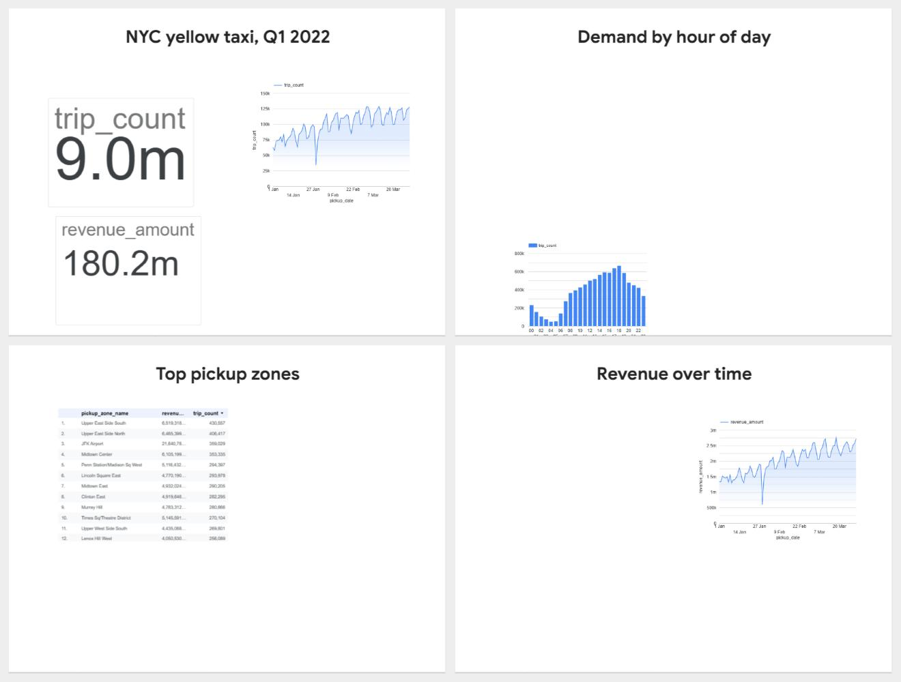

# nyc-taxi-bigquery-analytics

A personal learning project on **Google BigQuery**. It models real public NYC
taxi data with **dbt** into a tested star schema, then measures how partitioning
and clustering change bytes billed and runtime.

> **Scope, stated plainly:** this is a personal project run in the free BigQuery
> sandbox. It is not production work. Incremental models, snapshots and
> orchestration are in my separate dbt + DuckDB project, because the sandbox
> blocks the DML they need.

## Architecture

```
bigquery-public-data.new_york_taxi_trips (US)
  tlc_yellow_trips_2022, taxi_zone_geom
        |
        v
taxi_staging  (views)    stg_trips, stg_zones
        |
        v
taxi_marts    (tables)   dim_date, dim_zone, dim_payment_type,
                         fct_trips  (integer-range partitioned per day, clustered by zone + payment type),
                         agg_daily_zone, agg_hourly_demand
                         fct_trips_unpartitioned, fct_trips_partitioned  (perf study only)
        |
        v
Data Studio report (formerly Looker Studio; over agg_* tables)
```

| Model | Grain | Notes |
|---|---|---|
| `stg_trips` | one raw trip record | Renamed and typed. Each row carries `exclusion_reason` (NULL = valid). |
| `stg_zones` | one zone | Geometry dropped. |
| `dim_date` | one day | Generated from the date window vars. `date_key` (YYYYMMDD) joins to the fact. |
| `dim_zone` | one location id (1–265) | Adds 264 Unknown and 265 Outside of NYC, which the zone table lacks. |
| `dim_payment_type` | one payment code (0–6) | From the TLC data dictionary. |
| `fct_trips` | one valid trip | Integer-range partitioned on `pickup_date_key` (one partition per day), clustered by `pickup_zone_id, payment_type_id`. 9,016,981 rows. |
| `agg_daily_zone` | date × pickup zone | Trips, revenue, average tip, card tip rate, average duration and distance. |
| `agg_hourly_demand` | date × hour | Demand by hour. |

### Data

- Source: `bigquery-public-data.new_york_taxi_trips.tlc_yellow_trips_2022`. Checked
  on 2026-11-05: 36,256,539 rows, ~7.5 GB logical, **not partitioned**, location US.
- Window: pickups in Q1 2022 (vars `trip_start_date` / `trip_end_date` in
  `dbt_project.yml`). Because the source is unpartitioned, the window limits rows
  written but **not bytes scanned**. Each read of the source scans its columns
  for the whole year.
- Timestamps are New York local time stored as `TIMESTAMP`; treated as naive
  local time.

### Excluded rows

Staging keeps every row and labels it, so nothing disappears silently. Only
the first matching rule is recorded:

| Rule | Condition |
|---|---|
| `exact_duplicate` | the same raw row appears more than once (copies after the first) |
| `missing_timestamp` | pickup or dropoff is NULL |
| `dropoff_before_pickup` | dropoff < pickup |
| `duration_over_24h` | trip longer than 24 hours |
| `invalid_zone` | pickup or dropoff zone missing or outside 1–265 |
| `implausible_distance` | NULL, < 0 or > 200 miles |
| `negative_amount` | fare or total < 0 (refunds and voids) |
| `implausible_amount` | fare > $1,000 or total > $1,500 |
| `implausible_speed` | average speed > 100 mph on trips of at least 1 minute |

Counts per rule for Q1 2022, measured on 2026-11-05 with the same logic as
`analyses/profiling/exclusion_breakdown.sql`. The run processed 7.49 GB.

| Outcome | Rows | % of staging |
|---|---:|---:|
| kept (valid) | 9,016,981 | 99.40 |
| `negative_amount` | 48,595 | 0.54 |
| `dropoff_before_pickup` | 4,685 | 0.05 |
| `implausible_speed` | 634 | 0.007 |
| `implausible_distance` | 270 | 0.003 |
| `duration_over_24h` | 39 | <0.001 |
| `implausible_amount` | 1 | <0.001 |
| `exact_duplicate`, `missing_timestamp`, `invalid_zone` | 0 | 0 |
| **staging total** | **9,071,205** | 100 |

Three rules matched nothing in this window. They stay in the model because they
are cheap and guard other months. Valid trips by payment type: card
6,955,654; cash 1,735,208; not recorded (0) 285,905; no charge 28,763;
dispute 11,448; unknown 3. Voided (6) does not appear.

### Data quality tests

- `unique` / `not_null` on every key; `relationships` from `fct_trips` to all three dimensions.
- Range checks: distance 0–200, duration 0–1440 min, fare 0–1000, total 0–1500, hour 0–23, dropoff ≥ pickup.
- `assert_staging_fact_reconciliation`: staging rows = fact rows + excluded rows.
- `assert_no_implausible_speed`: singular anomaly test on the fact table.
- `assert_aggregates_match_fact`: both aggregate tables sum to the fact row count and are unique at their grain.

The generic tests `accepted_range` and `expression_is_true` live in
`tests/generic/`, so the project needs no packages and `dbt parse` runs offline.

## Performance study

Headline results (all measured; method and every number in
**[docs/performance.md](docs/performance.md)**):

| Finding | Measured |
|---|---|
| Partition pruning, one month of three | 276 MB → 91 MB billed (−67%) |
| Partition pruning, one day | 276 MB → 10 MB billed (−96%, at the 10 MB minimum) |
| Filtering on a date column that is not the partition column | 0% saved on the partitioned table |
| Extra saving from clustering on zone | −8% to −9% (small, because each day partition is small) |
| Filtering on the second cluster column alone | 0% saved |
| Dry-run estimate vs. actual on the clustered table | 275 MB estimated → 3.4 MB processed (one query) |
| `SELECT *` vs. 3 columns | −85% bytes processed; `LIMIT` saved nothing |
| `APPROX_COUNT_DISTINCT` vs. exact | same bytes, −43% slot time, −0.064% error |

See **[docs/performance.md](docs/performance.md)** for the details. Three designs of the same
fact table (unpartitioned, partitioned, partitioned + clustered), five queries,
dry run first, then three real runs each with the query cache off. It also
compares `SELECT *` against named columns and `COUNT(DISTINCT)` against
`APPROX_COUNT_DISTINCT`. Every number comes from
[`scripts/run_perf_study.py`](scripts/run_perf_study.py).

## BI layer

A four-page **Data Studio** report (Google renamed Looker Studio to Data Studio
in 2026). It is the free tool: **not Looker**, and no LookML. It reads
`agg_daily_zone` and `agg_hourly_demand` directly from BigQuery:

| Page | Content | Source |
|---|---|---|
| Overview | total valid trips (9.0M) and revenue ($180.2M), plus trips per day | `agg_daily_zone`, `agg_hourly_demand` |
| Demand by hour | trips by pickup hour: lowest around 04:00–05:00, highest around 18:00 | `agg_hourly_demand` |
| Top zones | top 15 pickup zones by trips, with revenue | `agg_daily_zone` |
| Revenue over time | revenue per day across Q1 2022 | `agg_daily_zone` |

Both totals match `fct_trips` exactly (9,016,981 trips; $180,225,234.56,
checked with a direct BigQuery query). The sharp dip in late January on both
time series most likely reflects the 29 January 2022 snowstorm.



The report is private to my Google account and uses owner's credentials.
The layout is basic, and fields keep their dbt column names (for example
`trip_count`).

## Running it

Requirements: Python 3.12, the gcloud CLI and a Google Cloud project with
BigQuery enabled (the sandbox is enough).

```bash
py -3.12 -m venv .venv && .venv/Scripts/activate   # Windows; on macOS/Linux: source .venv/bin/activate
pip install -r requirements.txt
gcloud auth application-default login
export GCP_PROJECT=your-project-id                   # PowerShell: $env:GCP_PROJECT="your-project-id"
```

```bash
dbt debug --profiles-dir .
dbt build --profiles-dir .                    # all models + tests
dbt build --profiles-dir . --select tag:perf --vars "{build_perf: true}"  # opt-in: the two extra fact variants
python scripts/run_perf_study.py --dry-run-only
python scripts/run_perf_study.py
```

The datasets `taxi_staging` and `taxi_marts` are created in the **US**
location. Public data is in the US, and BigQuery cannot read US data and write
to an EU dataset in the same query.

### Cost guardrails

- `maximum_bytes_billed: 15 GB` in `profiles.yml`. A query that would bill more fails instead of running.
- The perf script dry-runs every query first and caps each job at 5 GB.
- Measured cost of one full `dbt build`: building `fct_trips` processed 7.0 GiB
  and the reconciliation test scans the source again (~7 GB). Everything else
  reads the fact table (2.2 GiB to copy it, under 1 GiB per aggregate). The
  performance study adds ~9.4 GB. All of this is a small fraction of the
  sandbox's monthly free query allowance.

## Sandbox limitations

- **No DML** (`INSERT`, `UPDATE`, `DELETE`, `MERGE`), so no incremental models or
  snapshots. `CREATE OR REPLACE TABLE ... AS SELECT` works, so `view` and
  `table` materializations are used.
- **Tables expire** (60 days by default in the sandbox). The project rebuilds
  from scratch with one `dbt build`.
- **Time-unit partitions expire after 60 days too, measured from the partition
  date, not the load date.** My first build day-partitioned 2022 data and got a
  fact table with **0 rows**. Every column test passed on the empty table; only
  the staging-vs-fact reconciliation test caught it. The fix was integer-range
  partitioning on `pickup_date_key` (YYYYMMDD), which has no time-based expiry.
  The trade-off: queries must filter on `pickup_date_key` to prune. See
  [`macros/date_key_partition.sql`](macros/date_key_partition.sql).
- **Deleted data still counts against the 10 GB free storage limit** while it
  sits in BigQuery's time-travel window (up to 7 days). A clean rebuild on
  2026-11-05 (both datasets dropped, then `dbt build`) passed all 8 models and
  39 tests, but the two perf-study copies of `fct_trips` failed with *"exceeded
  quota for free storage"*: the copies I had just dropped were still counted.
  The perf copies are therefore opt-in (`--vars '{build_perf: true}'`), so a
  default `dbt build` fits in sandbox storage. Rebuild the perf copies only
  after the old ones have aged out of time travel.
- **Monthly query and storage quotas** apply; see the
  [sandbox documentation](https://cloud.google.com/bigquery/docs/sandbox).

## What this project does not cover

- Production deployment, scheduling, monitoring, alerting or IAM design.
- Incremental models, snapshots or orchestration (covered in my dbt + DuckDB project).
- Redshift. [docs/redshift_vs_bigquery.md](docs/redshift_vs_bigquery.md) is a reading note, not experience.
- Looker or LookML. The BI layer is Data Studio (formerly Looker Studio).

## CI

`.github/workflows/ci.yml` runs `dbt parse` and `sqlfluff lint` against a
placeholder project, with no warehouse connection and no credentials stored in
GitHub.
